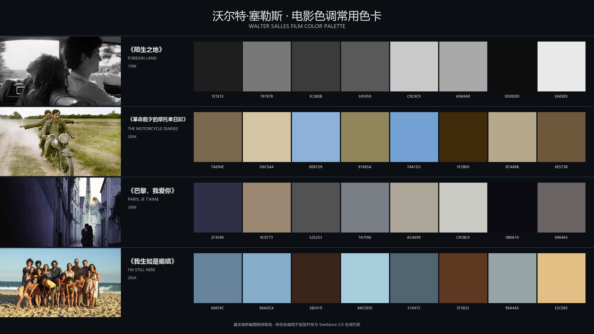
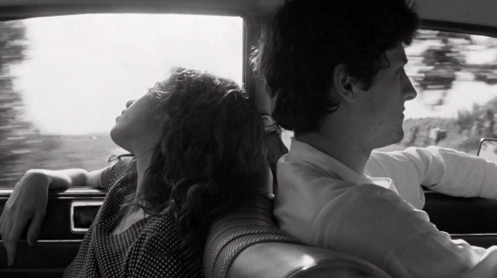
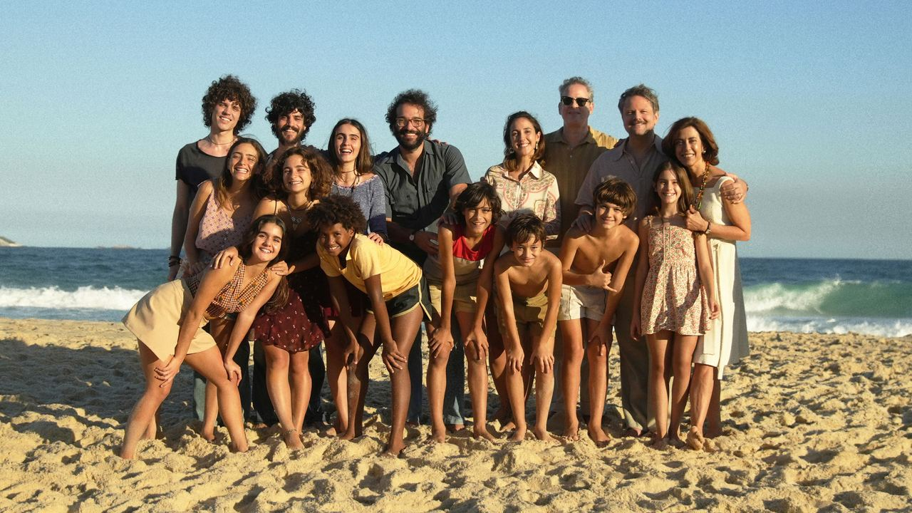

# 导演色卡 #052 — Walter Salles 沃尔特·塞勒斯

> **分类**：03 大地暖调与自然光诗意 | **编号**：052 | **国籍**：巴西 | **活跃年代**：1998-至今 | **创建日期**：2026-08-01

---

## 一、核心风格一句话
> 南美大地暖色与公路金黄交织的旅程诗，移动摄影机里流溢着拉美大地的温柔与辽阔。

---

## 二、色板构成

> 横版主色卡

### 主色板（6色）
| 色号 | HEX | 色彩名称 | 占比 | 来源说明 |
|------|-----|---------|------|---------|
| C01 | `#C48A3A` | 南美赭黄 | 22% | 《中央车站》巴西东北部 |
| C02 | `#8B5A2B` | 红土褐 | 18% | 《摩托日记》安第斯山路 |
| C03 | `#D4A855` | 公路金黄 | 16% | 《摩托日记》公路旅行 |
| C04 | `#5A6B3A` | 塞拉多绿 | 12% | 《中央车站》热带灌木 |
| C05 | `#E8C68A` | 焦糖肤 | 16% | 《中央车站》朵拉肤色 |
| C06 | `#6B4A3A` | 旧皮褐 | 16% | 《摩托日记》皮夹克/旧书 |

### 情绪色板（4色）
| 色号 | HEX | 色彩名称 | 情绪含义 |
|------|-----|---------|---------|
| E01 | `#F2D299` | 金穗黄 | 希望启程 |
| E02 | `#4A3728` | 深棕褐 | 乡愁沉淀 |
| E03 | `#D97B3A` | 落日橙 | 旅途炽热 |
| E04 | `#7A8C6B` | 草原青 | 自由宽广 |

### 光影特征
- **主光方向**：warm tropical sunlight, golden hour side light, dust motes in sun
- **高光色偏**：golden amber / warm yellow
- **阴影色偏**：deep umber / red-brown earth
- **对比比**：medium-high 60-75%, warm sun contrast
- **色调整体**：warm earthy golden, 80% warm + 20% cool

---

## 三、视觉风格关键词
### 构图与运镜
road movie traveling shots · south american landscape · golden hour natural light · moving vehicle perspective · handheld intimacy · wide horizon lines · dust and heat haze · historical road trip
### 色彩与光影
brazilian savanna ochre · andean mountain brown · highway golden dust · tropical sunset orange · caramel skin tone · cerrado green foliage · vintage leather brown · dusty bus window
### 氛围与情绪
latin american journey · coming of age on road · discovery of self and continent · paternal/mentor bond · working class warmth · political awakening · nostalgia for home · expansive freedom

---

## 四、运镜特征
| 特征 | 说明 | 经典例子 |
|------|------|---------|
| 公路移动 | 车窗视角移动构图 | 《中央车站》大巴车窗 |
| 黄金时刻 | 热带黄昏柔光 | 《摩托日记》公路日落 |
| 手持跟拍 | 贴近人物行走 | 《中央车站》火车站 |
| 地平线构图 | 广阔天地人物渺小 | 《摩托日记》安第斯山 |
| 尘雾热霾 | 热带空气扭曲 | 《中央车站》东北部 |
| 双人关系 | 老少/两人旅途构图 | 《中央车站》朵拉约书亚 |
| 书信朗读 | 文字与情感交织 | 《中央车站》读信场景 |
| 历史质感 | 颗粒感胶片质感 | 《摩托日记》50年代 |

---

## 五、经典场景色彩参考
### 电影截图画廊
| 中央车站 | 摩托日记 | 摩托日记山路 |
|----------|--------|--------------|
|  |  |  |
| 南美赭黄+焦糖肤 · 寻亲旅途 | 公路金黄+旧皮褐 · 青春觉醒 | 红土褐+塞拉多绿 · 大陆辽阔 |

| 中央车站东北 | 摩托日记麻风村 | 越位 |
|--------------|----------------|------|
|  | *麻风村（剧照未收录）* | *越位（剧照未收录）* |
| 南美赭黄+金穗黄 · 贫穷诗意 | 草原青+落日橙 · 理想主义 | 焦糖肤+红土褐 · 伊朗青春 |

沃尔特·塞勒斯的镜头永远在路上——南美赭黄是巴西东北干涸的大地，公路金黄在摩托扬起的尘土里闪闪发光，红土褐的安第斯山脉在远方静默。他的旅途从来不只是地理的移动，更是一次心灵的返乡：从中央车站的里约出发，在公路的尽头，找到比家更辽阔的大陆，比血缘更深的亲情。

### 电影色彩速查
| 电影 | 场景 | 主导色 | 色彩氛围 |
|------|------|--------|---------|
| 中央车站 | 里约火车站 | 南美赭黄+焦糖肤 · 寻亲启程 |
| 摩托日记 | 公路骑行日落 | 公路金黄+旧皮褐 · 青春觉醒 |
| 摩托日记 | 安第斯山山路 | 红土褐+塞拉多绿 · 大陆辽阔 |
| 中央车站 | 东北内陆小镇 | 南美赭黄+金穗黄 · 贫穷诗意 |
| 摩托日记 | 麻风村圣湖 | 草原青+落日橙 · 理想主义 |
| 越位 | 德黑兰街头 | 焦糖肤+红土褐 · 伊朗青春 |
| 黑暗中的视线 | 纪录片公路 | 旧皮褐+南美赭黄 · 电影寻根 |
| 在路上 | 美国公路 | 公路金黄+红土褐 · 垮掉一代 |

---

## 六、AI 生成提示词模板
### 图像生成速用公式
```
[subject description], in the style of Walter Salles, brazilian road movie aesthetic, south american earth tones, warm tropical golden sunlight, dusty highway travel, cinematic film still, journey and discovery, caramel skin tone, ochre and brown palette --ar 16:9 --style raw
```
### 视频生成速用公式
```
A warm cinematic road trip scene in Walter Salles style, south american landscape, golden hour tropical sunlight, dusty highway with motorcycle or bus, ochre and brown earth palette, journey of self-discovery, moving vehicle perspective, expansive horizon lines, heat haze and dust motes, intimate mentor-mentee bond
```

---

## 七、代表作索引
| 年份 | 片名 | 主要色彩特征 |
|------|------|-------------|
| 1998 | 中央车站 | 南美赭黄·寻亲旅途 |
| 2002 | 摩托日记 | 公路金黄·青春觉醒 |
| 2005 | 黑暗中的视线 | 旧皮褐·电影寻根 |
| 2006 | 巴黎，我爱你（拉雪兹神父段） | 暖灰调·法式浪漫 |
| 2008 | 越位 | 焦糖肤+红土褐·伊朗青春 |
| 2012 | 在路上 | 公路金黄·垮掉一代 |
| 2016 | 胡丽叶塔 | 冷灰调·阿莫多瓦剧本 |

---

## 八、蒸馏验证
- [x] 色板6+4色已提取
- [x] 运镜特征已归纳（8种）
- [x] 提示词模板已生成（MJ/SD/视频）
- [ ] 电影截图参考图已收集
- [ ] Stable Diffusion 实测试图
- [ ] Runway 视频测试
