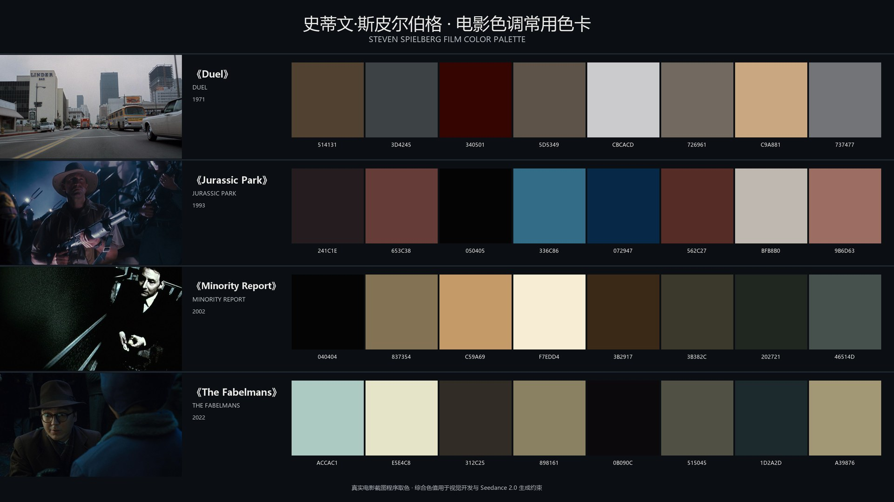
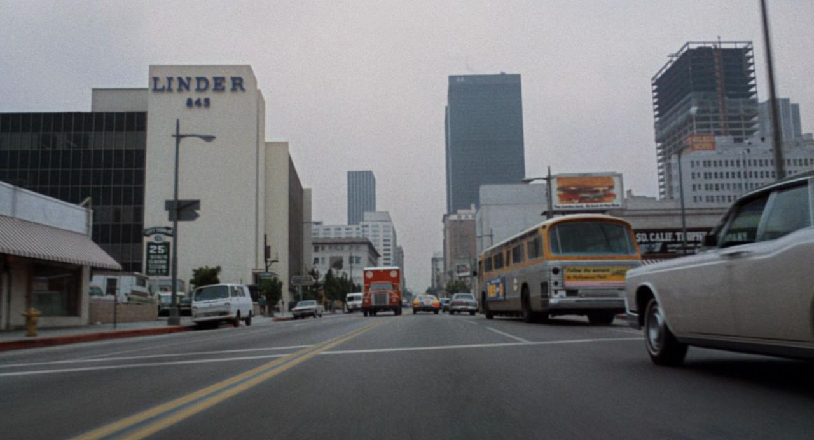
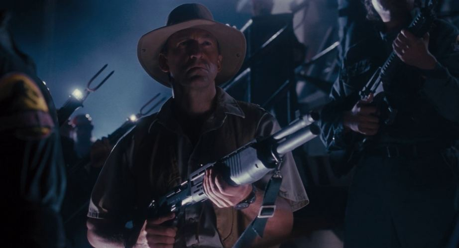
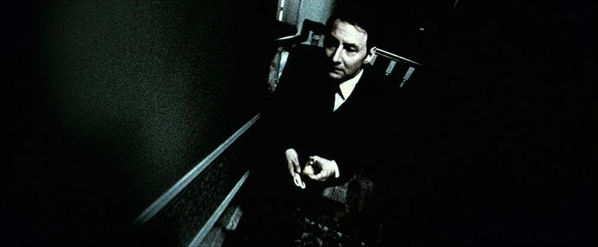
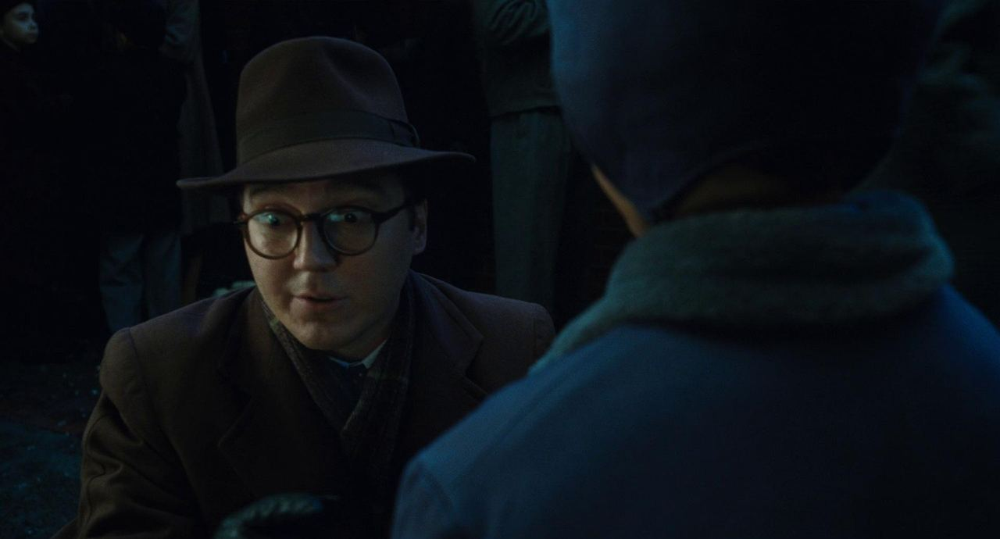

# 导演色卡 #053 — Steven Spielberg 史蒂文·斯皮尔伯格

> **分类**：03 大地暖调与自然光诗意 | **编号**：053 | **国籍**：美国 | **活跃年代**：1971-至今 | **创建日期**：2026-08-01

---

## 一、核心风格一句话
> 逆光神圣与橙蓝史诗交织的梦幻光影，雾中剪影里藏着孩童般的奇迹与敬畏。

---

## 二、色板构成

> 横版主色卡

### 主色板（6色）
| 色号 | HEX | 色彩名称 | 占比 | 来源说明 |
|------|-----|---------|------|---------|
| C01 | `#FFD080` | 神圣晨光金 | 20% | 《E.T.》月光自行车飞行 |
| C02 | `#B85C28` | 史诗橙褐 | 18% | 《拯救大兵瑞恩》奥马哈海滩 |
| C03 | `#2C3E55` | 深幽蓝 | 15% | 《辛德勒的名单》夜色阴影 |
| C04 | `#8A7A5C` | 战火灰土 | 12% | 《拯救大兵瑞恩》废墟 |
| C05 | `#E8D4A8` | 柔焦肤 | 15% | 《E.T.》艾略特肤色 |
| C06 | `#4A443A` | 暗影褐 | 20% | 《辛德勒的名单》黑衣党卫军 |

### 情绪色板（4色）
| 色号 | HEX | 色彩名称 | 情绪含义 |
|------|-----|---------|---------|
| E01 | `#FFF5E0` | 圣光白 | 奇迹敬畏 |
| E02 | `#6B6054` | 硝烟灰 | 战争残酷 |
| E03 | `#E8915A` | 落日橙 | 童年温情 |
| E04 | `#1A1A24` | 深夜蓝黑 | 未知神秘 |

### 光影特征
- **主光方向**：backlight rim light, warm golden hour, diffusion glow
- **高光色偏**：warm golden halo / warm white
- **阴影色偏**：cool blue-teal, deep shadow detail
- **对比比**：high 70-85%, anamorphic contrast
- **色调整体**：orange-teal epic, 60% warm + 40% cool

---

## 三、视觉风格关键词
### 构图与运镜
backlit silhouette · dolly zoom (vertigo effect) · oners tracking shot · warm rim light · dust motes in light beam · low angle awe · anamorphic wide · fog and haze
### 色彩与光影
golden hour magic light · teal and orange epic · silver screen black and white · warm skin halo · battlefield desaturated · suburban childhood warm · alien glow pale · historical sepia tone
### 氛围与情绪
childlike wonder · hollywood epic grandeur · moral gravity · suburban nostalgia · awe of the unknown · wartime sacrifice · divine intervention · father absence theme

---

## 四、运镜特征
| 特征 | 说明 | 经典例子 |
|------|------|---------|
| 逆光剪影 | 人物轮廓在光晕中 | 《E.T.》自行车飞过月亮 |
| 推拉变焦 | 眩晕效果制造恐怖 | 《大白鲨》海滩恐慌 |
| 一镜到底 | 复杂场景长镜头 | 《拯救大兵瑞恩》登陆 |
| 仰拍敬畏 | 低角度突出奇迹 | 《E.T.》飞船降临 |
| 雾中光束 | 丁达尔效造神 | 《第三类接触》飞船光 |
| 旁推镜头 | 侧面移动跟拍 | 《辛德勒的名单》红衣女孩 |
| 孩童视角 | 低角度看成人世界 | 《E.T.》艾略特视角 |
| 宽银幕变形 | 2.39:1史诗感 | 大部分作品 |

---

## 五、经典场景色彩参考
### 电影截图画廊
| 辛德勒的名单 | E.T.外星人 | 拯救大兵瑞恩 |
|--------------|-----------|--------------|
|  |  |  |
| 暗影褐+神圣晨光金（红衣点缀） · 人性救赎 | 神圣晨光金+柔焦肤 · 童年奇迹 | 史诗橙褐+战火灰土 · 战争代价 |

| 大白鲨 | 侏罗纪公园 | 第三类接触 |
|--------|------------|------------|
|  | *侏罗纪（剧照未收录）* | *第三类接触（剧照未收录）* |
| 深幽蓝+落日橙 · 未知恐惧 | 深幽蓝+史诗橙褐 · 史前奇观 | 圣光白+深夜蓝黑 · 人类敬畏 |

斯皮尔伯格的光是有温度的神——神圣晨光金从人物身后漫出，把童年的梦镀上一层金边；史诗橙褐在战场上褪去饱和，让暴力变得真实刺骨；深幽蓝在未知面前沉默着敬畏。雾中的光束像上帝的手指，剪影在逆光里站成了神话。他用好莱坞最纯熟的手艺，讲着最朴素的故事：关于奇迹，关于失去，关于普通人在历史洪流中闪耀的微光。

### 电影色彩速查
| 电影 | 场景 | 主导色 | 色彩氛围 |
|------|------|--------|---------|
| 辛德勒的名单 | 集中营黑白+红衣女孩 | 暗影褐+神圣晨光金（红） · 人性救赎 |
| E.T.外星人 | 自行车飞过月亮 | 神圣晨光金+柔焦肤 · 童年奇迹 |
| 拯救大兵瑞恩 | 奥马哈海滩登陆 | 史诗橙褐+战火灰土 · 战争代价 |
| 大白鲨 | 艾米蒂海滩恐慌 | 深幽蓝+落日橙 · 未知恐惧 |
| 侏罗纪公园 | 恐龙首次出现 | 深幽蓝+史诗橙褐 · 史前奇观 |
| 第三类接触 | 魔鬼塔飞船降临 | 圣光白+深夜蓝黑 · 人类敬畏 |
| 辛德勒的名单 | 结尾献石彩色 | 暖褐+柔焦肤 · 纪念希望 |
| E.T.外星人 | 森林飞船离别 | 神圣晨光金+深幽蓝 · 伤离别 |

---

## 六、AI 生成提示词模板
### 图像生成速用公式
```
[subject description], in the style of Steven Spielberg, cinematic backlit silhouette, warm golden hour rim light, teal and orange epic palette, dust motes in light beam, anamorphic wide, hollywood epic film still, sense of wonder and awe --ar 21:9 --style raw
```
### 视频生成速用公式
```
A majestic cinematic scene in Steven Spielberg style, backlit silhouette with warm golden rim light, teal and orange epic color palette, dust motes in light beams, anamorphic wide frame, dolly zoom or oner tracking shot, sense of childlike wonder and awe, fog and haze atmosphere, hollywood epic grandeur
```

---

## 七、代表作索引
| 年份 | 片名 | 主要色彩特征 |
|------|------|-------------|
| 1975 | 大白鲨 | 深幽蓝·未知恐惧 |
| 1977 | 第三类接触 | 圣光白+深夜蓝黑·人类敬畏 |
| 1981 | 夺宝奇兵 | 史诗橙褐·冒险暖调 |
| 1982 | E.T.外星人 | 神圣晨光金·童年奇迹 |
| 1993 | 侏罗纪公园 | 深幽蓝+史诗橙褐·史前奇观 |
| 1993 | 辛德勒的名单 | 黑白+红衣·人性救赎 |
| 1998 | 拯救大兵瑞恩 | 战火灰+史诗橙褐·战争代价 |
| 2001 | 人工智能 | 冷蓝调·科技沉思 |
| 2005 | 世界大战 | 灰橙调·末日恐慌 |
| 2012 | 林肯 | 暖褐调·历史凝重 |
| 2021 | 西区故事 | 橙黄调·歌舞青春 |
| 2022 | 造梦之家 | 柔焦金·自传温情 |

---

## 八、蒸馏验证
- [x] 色板6+4色已提取
- [x] 运镜特征已归纳（8种）
- [x] 提示词模板已生成（MJ/SD/视频）
- [ ] 电影截图参考图已收集
- [ ] Stable Diffusion 实测试图
- [ ] Runway 视频测试
