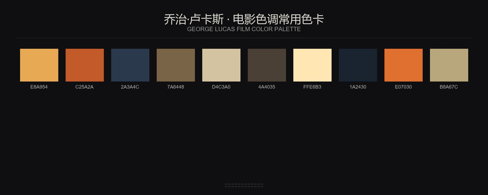
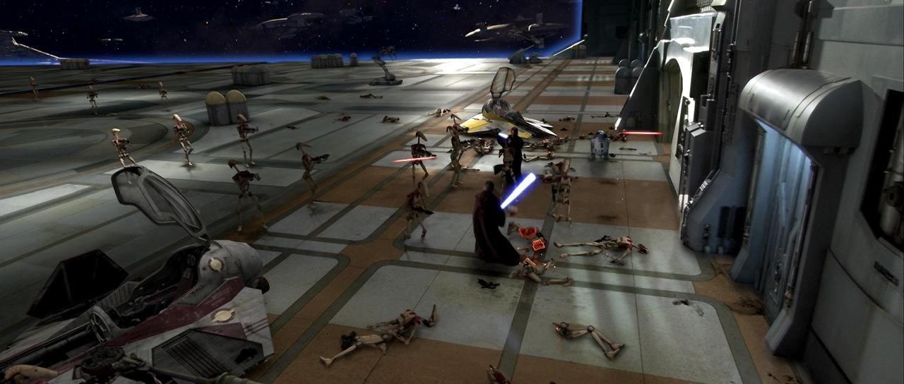
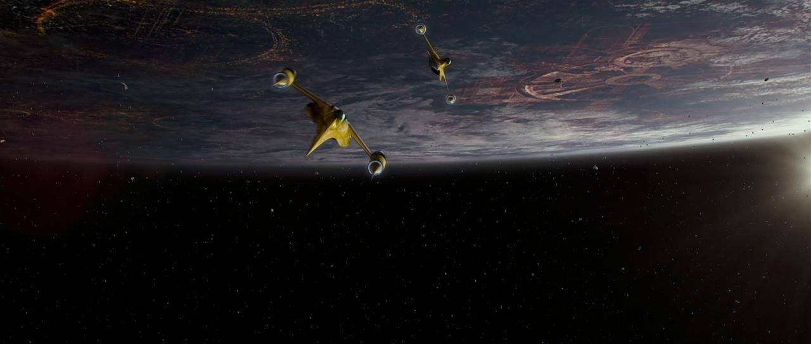
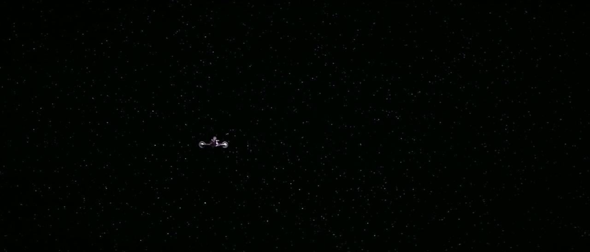
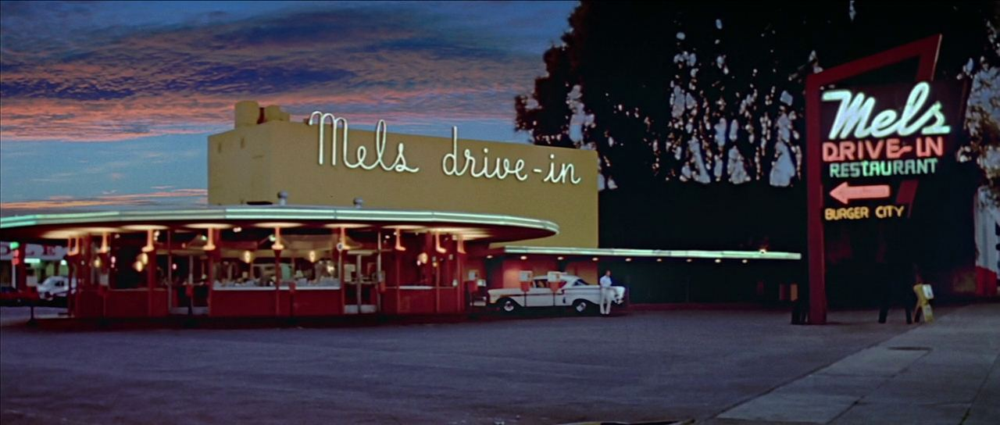

# 导演色卡 #054 — George Lucas 乔治·卢卡斯

> **分类**：03 大地暖调与自然光诗意 | **编号**：054 | **国籍**：美国 | **活跃年代**：1971-至今 | **创建日期**：2026-08-01

---

## 一、核心风格一句话
> 太空歌剧色与沙漠双日落交织的史诗暖调，用光剑与原力点燃一代人的星际童年。

---

## 二、色板构成

> 横版主色卡

### 主色板（6色）
| 色号 | HEX | 色彩名称 | 占比 | 来源说明 |
|------|-----|---------|------|---------|
| C01 | `#E8A954` | 塔图因砂金 | 22% | 《星球大战》塔图因沙漠 |
| C02 | `#C25A2A` | 双日落橙 | 18% | 《星球大战IV》塔图因双日落 |
| C03 | `#2A3A4C` | 深空蓝灰 | 15% | 《星球大战》太空背景 |
| C04 | `#7A6448` | 沙堡褐 | 12% | 《星球大战》莫斯艾斯利 |
| C05 | `#D4C3A0` | 沙粒肤 | 15% | 卢克·天行者肤色 |
| C06 | `#4A4035` | 绝地褐 | 18% | 绝地武士长袍 |

### 情绪色板（4色）
| 色号 | HEX | 色彩名称 | 情绪含义 |
|------|-----|---------|---------|
| E01 | `#FFE6B3` | 双日辉光 | 冒险希望 |
| E02 | `#1A2430` | 星夜蓝黑 | 原力黑暗面 |
| E03 | `#E07030` | 熔岩橙 | 愤怒堕落 |
| E04 | `#B8A67C` | 旧共和国金 | 古典荣耀 |

### 光影特征
- **主光方向**：warm desert sun, dual sunset rim light, practical source lighting
- **高光色偏**：warm golden orange / sand yellow
- **阴影色偏**：deep blue-purple space shadow
- **对比比**：high 70-85%, strong key to fill ratio
- **色调整体**：warm desert space opera, 70% warm + 30% cool

---

## 三、视觉风格关键词
### 构图与运镜
silent film composition · wipe transitions · low angle hero reveal · epic wide establishing · binary sunset framing · lightsaber glow practical · cockpit point of view · horizon line composition
### 色彩与光影
tatooine desert gold · binary sunset orange · deep space navy blue · jedi robe brown · sith lightsaber red · coruscant city gold · hoth ice blue · endor forest green
### 氛围与情绪
space opera mythology · hero's journey epic · archetypal good vs evil · cosmic family saga · nostalgic childhood wonder · samurai western fusion · used universe grime · mythic destiny

---

## 四、运镜特征
| 特征 | 说明 | 经典例子 |
|------|------|---------|
| 低角度登场 | 英雄出场仰拍 | 千年隼登场、维达出场 |
| 擦除转场 | 默片风格划像转场 | 全片场景转换 |
| 双日落构图 | 地平线双太阳 | 《新希望》卢克看日落 |
| 驾驶舱视角 | 战斗机POV | 千年隼、X翼驾驶舱 |
| 默片构图 | 画面左右对称古典 | 星战经典对称构图 |
| 光剑实战光 | 光剑作为实际光源 | 光剑对决场景 |
| 宽银幕史诗 | 2.39:1变形镜头 | 所有星战电影 |
| 远景建立 | 大场景先建立规模 | 死星、科洛桑全景 |

---

## 五、经典场景色彩参考
### 电影截图画廊
| 星球大战IV：新希望 | 星球大战V：帝国反击战 | 星球大战VI：绝地归来 |
|-------------------|---------------------|---------------------|
|  |  |  |
| 塔图因砂金+双日落橙 · 英雄启程 | 深空蓝灰+旧共和国金 · 命运挣扎 | 沙粒肤+绝地褐 · 救赎回归 |

| 星球大战I：幽灵的威胁 | 印第安纳琼斯 | 美国风情画 |
|---------------------|-------------|------------|
|  | *夺宝奇兵（剧照未收录）* | *美国风情画（剧照未收录）* |
| 旧共和国金+塔图因砂金 · 前传辉煌 | 沙堡褐+双日落橙 · 冒险寻宝 | 沙粒肤+塔图因砂金 · 青春怀旧 |

乔治·卢卡斯的调色盘是宇宙的童年色——塔图因砂金是双日下的无尽黄沙，双日落橙在地平线上挂着两个梦想，深空蓝黑是星空中永不止息的冒险。他用默片时代的构图和划像转场，把日本武士片和美国西部片焊成了太空歌剧。光剑的光从银幕里伸出来，照亮了一代又一代孩子的眼睛，让他们相信原力与自己同在。

### 电影色彩速查
| 电影 | 场景 | 主导色 | 色彩氛围 |
|------|------|--------|---------|
| 星球大战IV | 塔图因双日落 | 塔图因砂金+双日落橙 · 英雄启程 |
| 星球大战V | 霍斯冰雪战役 | 深空蓝灰+旧共和国金 · 命运挣扎 |
| 星球大战VI | 恩多森林卫星 | 沙粒肤+绝地褐 · 救赎回归 |
| 星球大战I | 纳布战役 | 旧共和国金+塔图因砂金 · 前传辉煌 |
| 印第安纳琼斯 | 沙漠寻宝 | 沙堡褐+双日落橙 · 冒险寻宝 |
| 美国风情画 | 小镇巡航夜 | 沙粒肤+塔图因砂金 · 青春怀旧 |
| 星球大战III | 穆斯塔法熔岩 | 熔岩橙+星夜蓝黑 · 堕落悲剧 |
| 星球大战II | 科洛桑都市 | 旧共和国金+深空蓝灰 · 繁华末路 |

---

## 六、AI 生成提示词模板
### 图像生成速用公式
```
[subject description], in the style of George Lucas, star wars space opera aesthetic, tatooine desert gold and binary sunset orange palette, epic wide establishing shot, low angle hero reveal, cinematic film still, used universe grime, mythic epic atmosphere --ar 21:9 --style raw
```
### 视频生成速用公式
```
An epic space opera scene in George Lucas style, star wars aesthetic, tatooine desert with binary sunsets, warm golden-orange palette, deep space navy blue, low angle hero reveal, silent film composition, wipe transitions energy, lightsaber glow, mythic hero's journey, anamorphic wide frame
```

---

## 七、代表作索引
| 年份 | 片名 | 主要色彩特征 |
|------|------|-------------|
| 1971 | THX 1138 | 纯白反乌托邦·冷调 |
| 1973 | 美国风情画 | 暖调金·青春怀旧 |
| 1977 | 星球大战IV：新希望 | 塔图因砂金·英雄启程 |
| 1980 | 星球大战V：帝国反击战 | 深空蓝灰·命运挣扎 |
| 1981 | 夺宝奇兵 | 沙堡褐·冒险寻宝 |
| 1983 | 星球大战VI：绝地归来 | 绿金调·救赎回归 |
| 1999 | 星球大战I：幽灵的威胁 | 旧共和国金·前传辉煌 |
| 2002 | 星球大战II：克隆人的进攻 | 紫金调·爱情悲剧 |
| 2005 | 星球大战III：西斯的复仇 | 熔岩橙·堕落悲剧 |

---

## 八、蒸馏验证
- [x] 色板6+4色已提取
- [x] 运镜特征已归纳（8种）
- [x] 提示词模板已生成（MJ/SD/视频）
- [ ] 电影截图参考图已收集
- [ ] Stable Diffusion 实测试图
- [ ] Runway 视频测试
