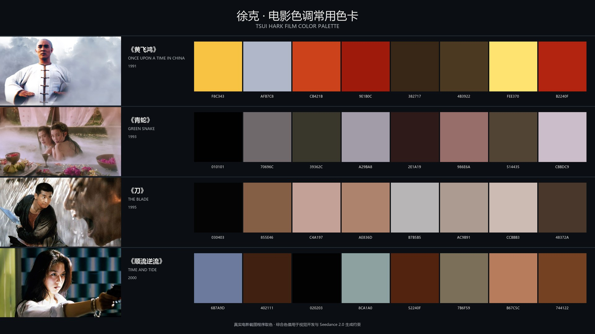
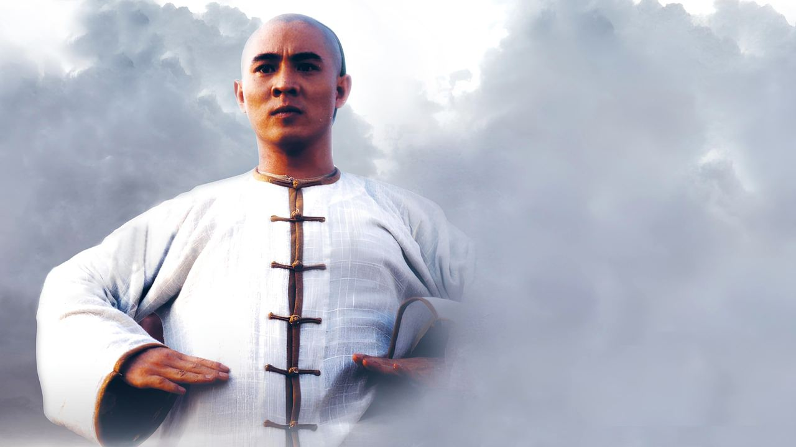
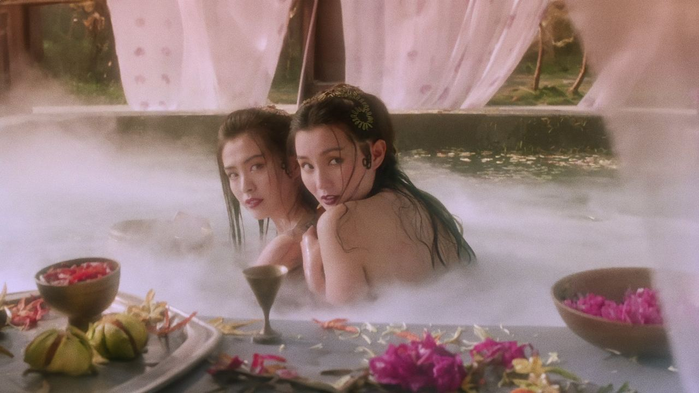
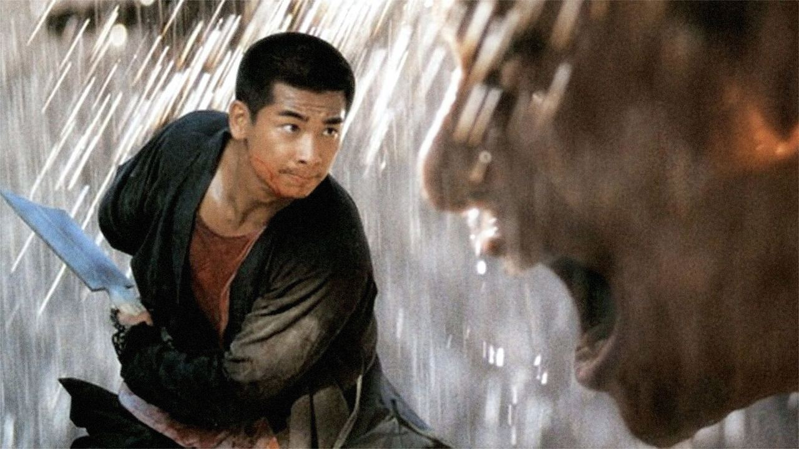
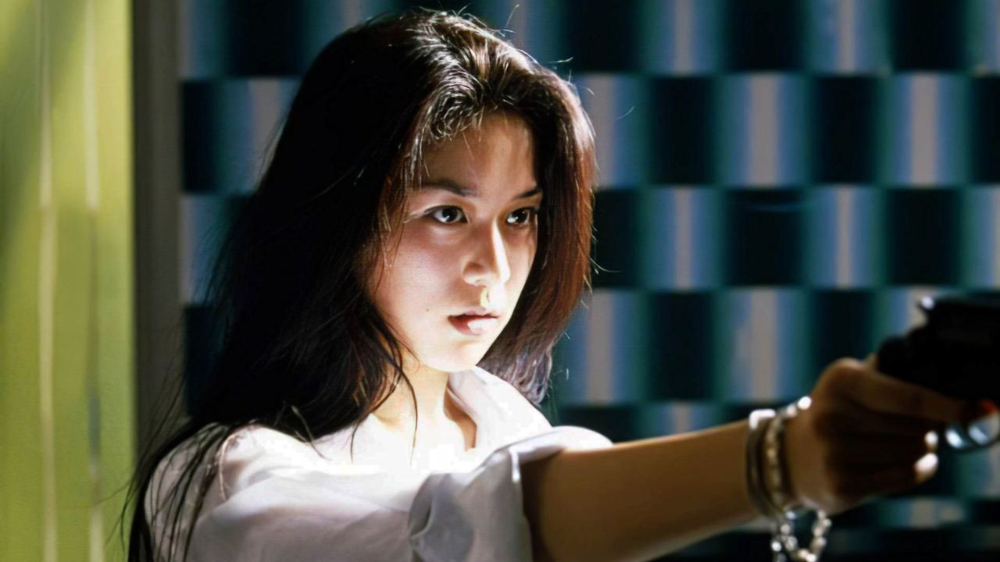

# 导演色卡 #055 — Tsui Hark 徐克

> **分类**：03 大地暖调与自然光诗意 | **编号**：055 | **国籍**：中国香港 | **活跃年代**：1979-至今 | **创建日期**：2026-08-01

---

## 一、核心风格一句话
> 水墨飞天与黄沙剑气交织的武侠飘逸，快速剪辑中流淌的东方诗意。

---

## 二、色板构成

> 横版主色卡

### 主色板（6色）
| 色号 | HEX | 色彩名称 | 占比 | 来源说明 |
|------|-----|---------|------|---------|
| C01 | `#C8964A` | 大漠金沙 | 22% | 黄飞鸿沙漠武打 |
| C02 | `#7A3B1F` | 朱砂赤红 | 18% | 新龙门客栈血焰 |
| C03 | `#2D3A2E` | 青竹墨绿 | 15% | 狄仁杰竹林 |
| C04 | `#E8D5A8` | 宣纸米白 | 15% | 飞天水墨留白 |
| C05 | `#5C5448` | 青灰瓦黛 | 15% | 龙门客栈外景 |
| C06 | `#D6B98A` | 土黄赭石 | 15% | 黄飞鸿佛山街景 |

### 情绪色板（4色）
| 色号 | HEX | 色彩名称 | 情绪含义 |
|------|-----|---------|---------|
| E01 | `#FF4500` | 烈火红 | 江湖热血 |
| E02 | `#DAA520` | 金箔黄 | 豪情壮志 |
| E03 | `#4B0082` | 靛蓝夜 | 神秘阴谋 |
| E04 | `#F5F5DC` | 飞雪白 | 飘逸超脱 |

### 光影特征
- **主光方向**：warm backlit dust, ink-wash smoke haze, natural daylight with gold rim
- **高光色偏**：golden amber / warm ochre
- **阴影色偏**：deep umber / teal-green
- **对比比**：high 70-85%
- **色调整体**：warm earth + ink wash, 65% warm + 35% cool

---

## 三、视觉风格关键词
### 构图与运镜
wire-fu flying motion · quick-cut montage · ink-wash smoke haze · low-angle heroic framing · dust and debris in light · extreme wide martial arts · dynamic tracking shot · Chinese classical composition
### 色彩与光影
desert golden sand · vermilion red blood · bamboo ink green · rice-paper pale cream · flying silk white · golden hour kung fu · ink-wash monochrome · earth-tone wuxia
### 氛围与情绪
martial heroism · ink-wash poetry · jianghu wanderlust · chivalric romance · dynastic intrigue · flying transcendence · hot desert passion · ancient Chinese mystery

---

## 四、运镜特征
| 特征 | 说明 | 经典例子 |
|------|------|---------|
| 飞天钢丝 | 威亚动作飘逸如仙 | 《新龙门客栈》林青霞飞天 |
| 快速剪辑 | 每秒十余切营造凌厉 | 黄飞鸿武打场面 |
| 低角度仰拍 | 英雄气概崇高感 | 《黄飞鸿》佛山登场 |
| 烟雾水墨 | 烟霞营造东方意境 | 《狄仁杰》龙王庙 |
| 广角拉伸 | 空间纵深感夸张 | 《龙门飞甲》沙漠 |
| 逆光尘粒 | 金尘飞扬浪漫武打 | 黄飞鸿夕阳比武 |
| 动态跟拍 | 武打流畅一气呵成 | 《新龙门客栈》客栈乱斗 |
| 对称构图 | 中国古典美学 | 《狄仁杰》宫殿 |

---

## 五、经典场景色彩参考
### 电影截图画廊
| 黄飞鸿 | 新龙门客栈 | 狄仁杰之神都龙王 |
|--------|--------|--------|
|  |  |  |
| 大漠金沙+土黄赭石 · 佛山豪情 | 朱砂赤红+青灰瓦黛 · 江湖险局 | 青竹墨绿+宣纸米白 · 盛唐奇案 |

| 龙门飞甲 | 蜀山传 | 七剑 |
|--------|--------|--------|
|  | *蜀山传（剧照未收录）* | *七剑（剧照未收录）* |
| 大漠金沙+飞雪白 · 沙漠飞侠 | 靛蓝夜+金箔黄 · 仙侠飞天 | 青灰瓦黛+宣纸米白 · 塞外刀光 |

金沙、朱砂与竹墨包围侠士，烟霞与飞纱把武打化为水墨长卷。

### 电影色彩速查
| 电影 | 场景 | 主导色 | 色彩氛围 |
|------|------|--------|---------|
| 黄飞鸿 | 佛山街景比武 | 大漠金沙+土黄赭石 | 武侠豪情 |
| 新龙门客栈 | 客栈乱斗 | 朱砂赤红+青灰瓦黛 | 江湖险局 |
| 狄仁杰之神都龙王 | 洛阳水殿 | 青竹墨绿+宣纸米白 | 盛唐奇案 |
| 龙门飞甲 | 沙漠追打 | 大漠金沙+飞雪白 | 沙漠飞侠 |
| 蜀山传 | 仙山飞天 | 靛蓝夜+金箔黄 | 仙侠奇幻 |
| 七剑 | 天山风雪 | 青灰瓦黛+宣纸米白 | 塞外刀光 |
| 青蛇 | 西湖烟雨 | 青竹墨绿+宣纸米白 | 妖媚诗意 |
| 笑傲江湖 | 华山论剑 | 青竹墨绿+朱砂赤红 | 江湖逍遥 |

---

## 六、AI 生成提示词模板
### 图像生成速用公式
```
[subject description], in the style of Tsui Hark, desert golden sand, wire-fu flying motion, cinematic film look, natural lighting, warm earth tones, martial heroism, --ar 16:9 --style raw
```
### 视频生成速用公式
```
A cinematic scene in Tsui Hark style, warm backlit dust, ink-wash smoke haze, natural daylight with gold rim, desert golden sand, wire-fu flying motion, martial heroism, epic atmosphere, 16:9, cinematic movement
```

---

## 七、代表作索引
| 年份 | 片名 | 主要色彩特征 |
|------|------|-------------|
| 1979 | 蝶变 | 悬疑武侠处女作 |
| 1983 | 新蜀山剑侠 | 仙侠飞天特效 |
| 1991 | 黄飞鸿 | 佛山豪情金沙 |
| 1992 | 新龙门客栈 | 沙漠客栈侠情 |
| 1993 | 青蛇 | 西湖烟雨妖魅 |
| 2010 | 狄仁杰之通天帝国 | 盛唐悬疑 |
| 2011 | 龙门飞甲 | 3D沙漠武侠 |
| 2013 | 狄仁杰之神都龙王 | 深海奇案 |

---

## 八、蒸馏验证
- [x] 色板6+4色已提取
- [x] 运镜特征已归纳（8种）
- [x] 提示词模板已生成（MJ/SD/视频）
- [ ] 电影截图参考图已收集
- [ ] Stable Diffusion 实测试图
- [ ] Runway 视频测试
