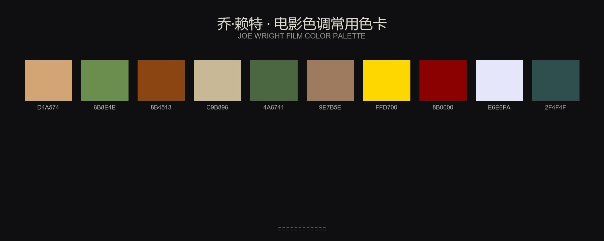
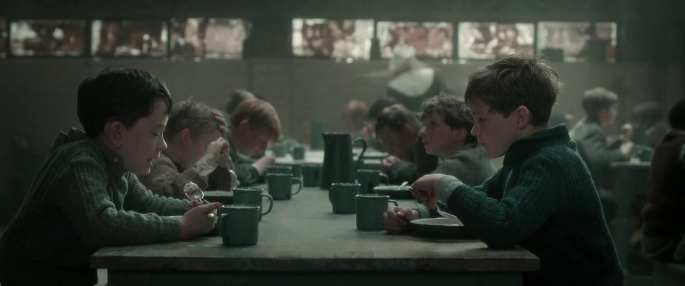
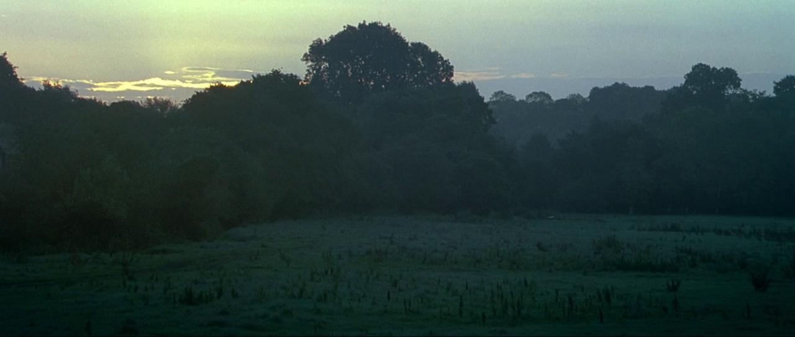
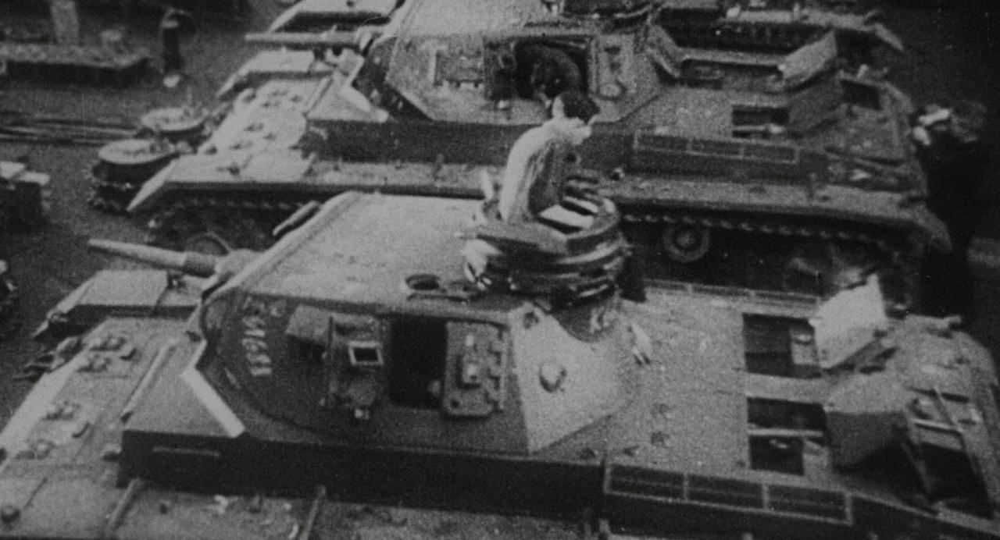

# 导演色卡 #056 — Joe Wright 乔·赖特

> **分类**：03 大地暖调与自然光诗意 | **编号**：056 | **国籍**：英国 | **活跃年代**：2000-至今 | **创建日期**：2026-08-01

---

## 一、核心风格一句话
> 金色长镜头与田园柔光交织的古典油画质感，英国文学的诗意影像化。

---

## 二、色板构成

> 横版主色卡

### 主色板（6色）
| 色号 | HEX | 色彩名称 | 占比 | 来源说明 |
|------|-----|---------|------|---------|
| C01 | `#D4A574` | 落日暖金 | 22% | 赎罪金色麦田 |
| C02 | `#6B8E4E` | 田园草绿 | 18% | 傲慢与偏见原野 |
| C03 | `#8B4513` | 胡桃木棕 | 15% | 古典室内木色 |
| C04 | `#C9B896` | 奶油米色 | 15% | 暖光下皮肤 |
| C05 | `#4A6741` | 松柏深绿 | 15% | 至暗时刻议会 |
| C06 | `#9E7B5E` | 陶土砖红 | 15% | 英伦砖石建筑 |

### 情绪色板（4色）
| 色号 | HEX | 色彩名称 | 情绪含义 |
|------|-----|---------|---------|
| E01 | `#FFD700` | 黄金时刻 | 浪漫狂喜 |
| E02 | `#8B0000` | 暗红血渍 | 战争悲剧 |
| E03 | `#E6E6FA` | 薰衣草紫 | 初恋心动 |
| E04 | `#2F4F4F` | 暗松绿 | 压抑隐忍 |

### 光影特征
- **主光方向**：golden hour long take, soft pastoral diffused light, classical painting chiaroscuro
- **高光色偏**：warm honey gold / butter yellow
- **阴影色偏**：deep forest green / umber brown
- **对比比**：medium 55-70%
- **色调整体**：warm golden pastoral, 70% warm + 30% cool

---

## 三、视觉风格关键词
### 构图与运镜
long tracking take · fluid camera movement · symmetrical framing · painterly composition · depth through doorways · low-angle romantic · dancing camera · period costume detail
### 色彩与光影
golden hour wheat field · pastoral green meadow · walnut wood interior · cream skin tones · english country garden · candlelight amber · dusty window light · oil painting palette
### 氛围与情绪
literary romance · british period elegance · melancholic nostalgia · golden memory · wartime tragedy · social constraint · whispered passion · classical beauty

---

## 四、运镜特征
| 特征 | 说明 | 经典例子 |
|------|------|---------|
| 长镜头调度 | 整段戏一气呵成 | 《赎罪》敦刻尔克海滩 |
| 跟踪运镜 | 跟随人物穿堂入室 | 《傲慢与偏见》舞会 |
| 对称构图 | 古典秩序美学 | 《至暗时刻》议会 |
| 门框叙事 | 通过门框观察人物 | 《赎罪》庄园走廊 |
| 舞蹈镜头 | 摄影机与人物共舞 | 《傲慢与偏见》舞会 |
| 低角度英雄 | 丘吉尔的历史重量 | 《至暗时刻》演讲 |
| 晨光窗纱 | 薄纱过滤的暖光 | 《赎罪》卧室清晨 |
| 雨中诗意 | 雨幕中的情感爆发 | 《傲慢与偏见》雨中告白 |

---

## 五、经典场景色彩参考
### 电影截图画廊
| 赎罪 | 傲慢与偏见 | 至暗时刻 |
|--------|--------|--------|
|  |  |  |
| 落日暖金+奶油米色 · 金色回忆 | 田园草绿+奶油米色 · 田园爱情 | 松柏深绿+胡桃木棕 · 历史重量 |

| 安娜·卡列尼娜 | 独奏者 | 汉娜 |
|--------|--------|--------|
|  | *独奏者（剧照未收录）* | *汉娜（剧照未收录）* |
| 陶土砖红+落日暖金 · 舞台化悲剧 | 落日暖金+胡桃木棕 · 街头音乐 | 松柏深绿+田园草绿 · 少女逃亡 |

金麦、草绿与胡桃棕包围人物，柔光与长镜把文学化为流动的油画。

### 电影色彩速查
| 电影 | 场景 | 主导色 | 色彩氛围 |
|------|------|--------|---------|
| 赎罪 | 金色麦田奔跑 | 落日暖金+奶油米色 | 金色回忆 |
| 傲慢与偏见 | 原野晨雾相遇 | 田园草绿+奶油米色 | 田园爱情 |
| 至暗时刻 | 议会演讲 | 松柏深绿+胡桃木棕 | 历史重量 |
| 安娜·卡列尼娜 | 剧院舞台 | 陶土砖红+落日暖金 | 舞台悲剧 |
| 独奏者 | 洛杉矶街头 | 落日暖金+胡桃木棕 | 街头诗意 |
| 汉娜 | 森林雪地逃亡 | 松柏深绿+田园草绿 | 少女冒险 |
| 赎罪 | 敦刻尔克海滩 | 落日暖金+暗红血渍 | 战争悲剧 |
| 傲慢与偏见 | 雨中告白 | 田园草绿+薰衣草紫 | 情感爆发 |

---

## 六、AI 生成提示词模板
### 图像生成速用公式
```
[subject description], in the style of Joe Wright, golden hour wheat field, long tracking take, cinematic film look, natural lighting, warm earth tones, literary romance, --ar 16:9 --style raw
```
### 视频生成速用公式
```
A cinematic scene in Joe Wright style, golden hour long take, soft pastoral diffused light, classical painting chiaroscuro, golden hour wheat field, long tracking take, literary romance, epic atmosphere, 16:9, cinematic movement
```

---

## 七、代表作索引
| 年份 | 片名 | 主要色彩特征 |
|------|------|-------------|
| 2005 | 傲慢与偏见 | 田园柔光文学爱情 |
| 2007 | 赎罪 | 金色长镜头战争 |
| 2011 | 汉娜 | 北欧冷调动作 |
| 2012 | 安娜·卡列尼娜 | 舞台化古典悲剧 |
| 2017 | 至暗时刻 | 议会暗黑历史 |
| 2021 | 西拉诺 | 浪漫音乐剧 |
| 2023 | 势不两立 | 悬疑心理 |

---

## 八、蒸馏验证
- [x] 色板6+4色已提取
- [x] 运镜特征已归纳（8种）
- [x] 提示词模板已生成（MJ/SD/视频）
- [ ] 电影截图参考图已收集
- [ ] Stable Diffusion 实测试图
- [ ] Runway 视频测试
