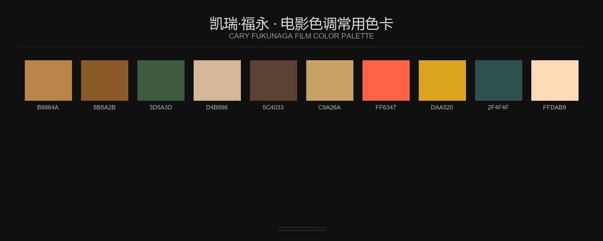
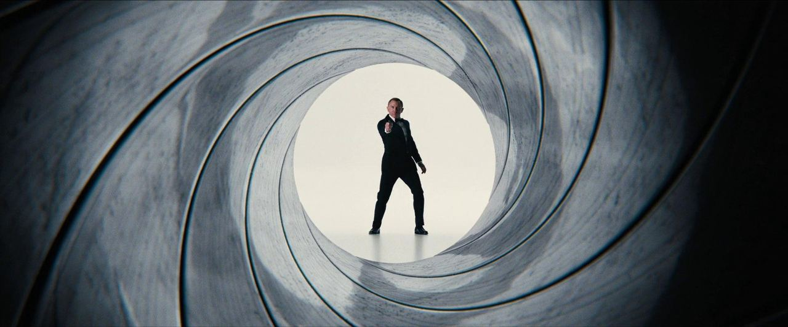
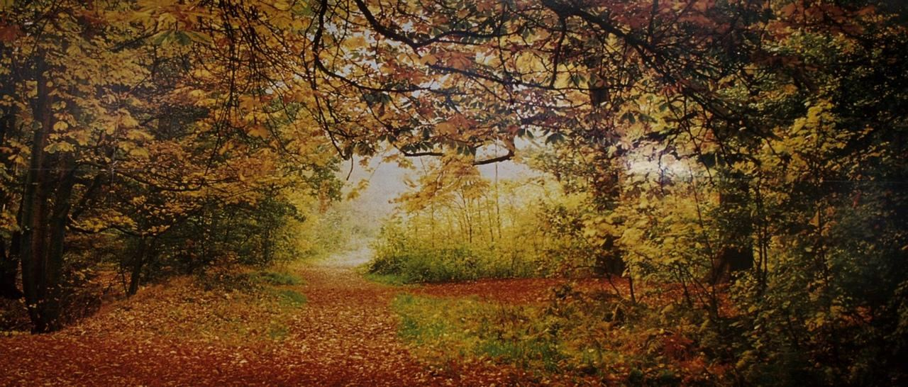
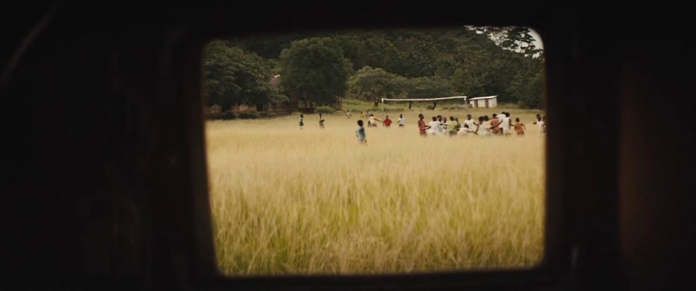
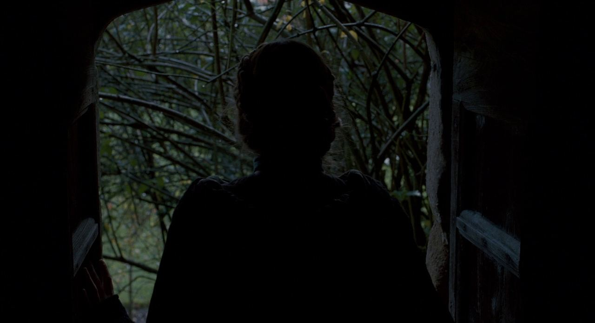

# 导演色卡 #057 — Cary Fukunaga 凯瑞·福永

> **分类**：03 大地暖调与自然光诗意 | **编号**：057 | **国籍**：美国 | **活跃年代**：2006-至今 | **创建日期**：2026-08-01

---

## 一、核心风格一句话
> 暖土战地与金色非洲交织的优雅暴力，在荒凉中开出的诗意美学。

---

## 二、色板构成

> 横版主色卡

### 主色板（6色）
| 色号 | HEX | 色彩名称 | 占比 | 来源说明 |
|------|-----|---------|------|---------|
| C01 | `#B8864A` | 沙漠土黄 | 22% | 007战地沙漠 |
| C02 | `#8B5A2B` | 焦土棕褐 | 18% | 真探路易斯安那 |
| C03 | `#3D5A3D` | 沼泽深绿 | 15% | 真探沼泽林 |
| C04 | `#D4B896` | 暖沙肤色 | 15% | 非洲金阳光下肤色 |
| C05 | `#5C4033` | 深棕暗影 | 15% | 暴力场景阴影 |
| C06 | `#C9A26A` | 金晖夕照 | 15% | 非洲日落剪影 |

### 情绪色板（4色）
| 色号 | HEX | 色彩名称 | 情绪含义 |
|------|-----|---------|---------|
| E01 | `#FF6347` | 战场血橙 | 残酷暴力 |
| E02 | `#DAA520` | 非洲金 | 希望与求生 |
| E03 | `#2F4F4F` | 沼泽蓝灰 | 压抑迷思 |
| E04 | `#FFDAB9` | 柔光回忆 | 温暖过往 |

### 光影特征
- **主光方向**：golden hour desert light, soft dust diffusion, naturalism with poetic framing
- **高光色偏**：warm ochre / golden desert
- **阴影色偏**：deep umber / swamp teal
- **对比比**：medium-high 65-80%
- **色调整体**：warm earth tones, 65% warm + 35% cool

---

## 三、视觉风格关键词
### 构图与运镜
long tracking shots · elegant slow pan · symmetrical violence · low angle heroic · silhouette against sunset · dust particles in light · depth through doorways · lingering wide shots
### 色彩与光影
desert sand ochre · burnt earth brown · swamp moss green · golden african sunset · warm dust haze · blood orange violence · teal-green shadows · natural skin warmth
### 氛围与情绪
quiet violence · existential dread · african resilience · southern gothic · elegant brutality · nostalgic warmth · moral ambiguity · lonesome journey

---

## 四、运镜特征
| 特征 | 说明 | 经典例子 |
|------|------|---------|
| 长镜头追踪 | 优雅跟拍暴力场面 | 《真探》第一季长镜头 |
| 剪影夕照 | 人物剪影与非洲日落 | 《无境之兽》结尾 |
| 对称暴力 | 工整构图中的残酷 | 《007：无暇赴死》开场 |
| 尘土光束 | 丁达尔尘粒营造氛围 | 《无境之兽》村庄 |
| 低角度英雄 | 人物的孤独英雄感 | 《007：无暇赴死》邦德 |
| 沼泽雾气 | 潮湿迷雾制造悬疑 | 《真探》沼泽 |
| 门口框架 | 通过门框观察世界 | 《简爱》庄园大门 |
| 缓推凝视 | 缓慢推近逼视人物 | 《真探》审讯 |

---

## 五、经典场景色彩参考
### 电影截图画廊
| 007：无暇赴死 | 真探 第一季 | 无境之兽 |
|--------|--------|--------|
|  |  |  |
| 沙漠土黄+金晖夕照 · 优雅特工 | 沼泽深绿+焦土棕褐 · 南方哥特 | 沙漠土黄+暖沙肤色 · 非洲战场 |

| 简爱 | 边境风云 | 疯子 |
|--------|--------|--------|
|  | *边境风云（剧照未收录）* | *疯子（剧照未收录）* |
| 深棕暗影+暖沙肤色 · 哥特爱情 | 焦土棕褐+沙漠土黄 · 移民之旅 | 沼泽蓝灰+金晖夕照 · 迷幻心理 |

土黄、焦棕与沼泽绿包裹人物，优雅镜头把暴力化为荒野诗行。

### 电影色彩速查
| 电影 | 场景 | 主导色 | 色彩氛围 |
|------|------|--------|---------|
| 007：无暇赴死 | 沙漠古巴追逐 | 沙漠土黄+金晖夕照 | 优雅特工 |
| 真探第一季 | 路易斯安那沼泽 | 沼泽深绿+焦土棕褐 | 南方哥特 |
| 无境之兽 | 非洲丛林战争 | 沙漠土黄+暖沙肤色 | 童兵悲剧 |
| 简爱 | 桑菲尔德庄园 | 深棕暗影+暖沙肤色 | 哥特爱情 |
| 边境风云 | 墨西哥火车顶 | 焦土棕褐+沙漠土黄 | 移民求生 |
| 疯子 | 纽约心理实验 | 沼泽蓝灰+金晖夕照 | 迷幻心理 |
| 007：无暇赴死 | 森林爆破 | 战场血橙+深棕暗影 | 优雅暴力 |
| 真探第一季 | 荒野追凶 | 沼泽深绿+金晖夕照 | 存在主义 |

---

## 六、AI 生成提示词模板
### 图像生成速用公式
```
[subject description], in the style of Cary Fukunaga, desert sand ochre, long tracking shots, cinematic film look, natural lighting, warm earth tones, quiet violence, --ar 16:9 --style raw
```
### 视频生成速用公式
```
A cinematic scene in Cary Fukunaga style, golden hour desert light, soft dust diffusion, naturalism with poetic framing, desert sand ochre, long tracking shots, quiet violence, epic atmosphere, 16:9, cinematic movement
```

---

## 七、代表作索引
| 年份 | 片名 | 主要色彩特征 |
|------|------|-------------|
| 2009 | 边境风云 | 墨西哥移民题材 |
| 2011 | 简爱 | 哥特式古典爱情 |
| 2014 | 真探 第一季 | 南方哥特悬疑剧 |
| 2015 | 无境之兽 | 非洲童兵战争 |
| 2018 | 疯子 | 迷幻心理剧集 |
| 2021 | 007：无暇赴死 | 优雅暴力特工 |
| 2024 | 未来未定 | 持续创作中 |

---

## 八、蒸馏验证
- [x] 色板6+4色已提取
- [x] 运镜特征已归纳（8种）
- [x] 提示词模板已生成（MJ/SD/视频）
- [ ] 电影截图参考图已收集
- [ ] Stable Diffusion 实测试图
- [ ] Runway 视频测试
