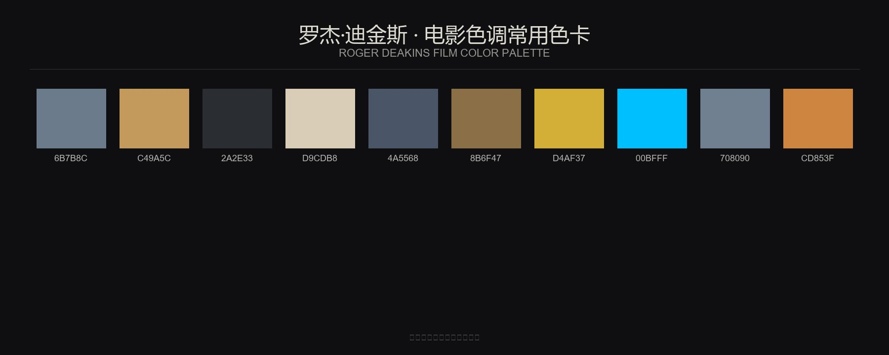
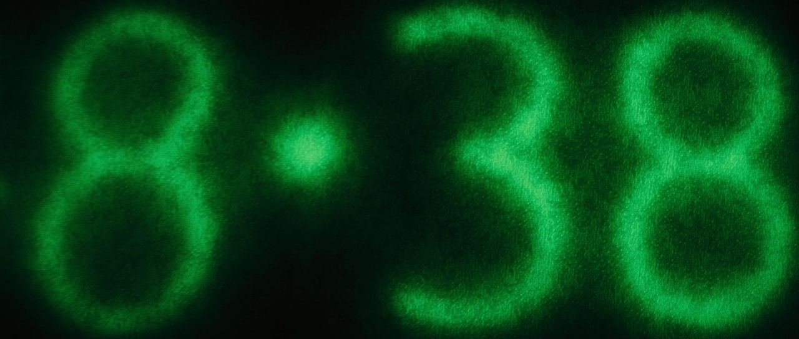
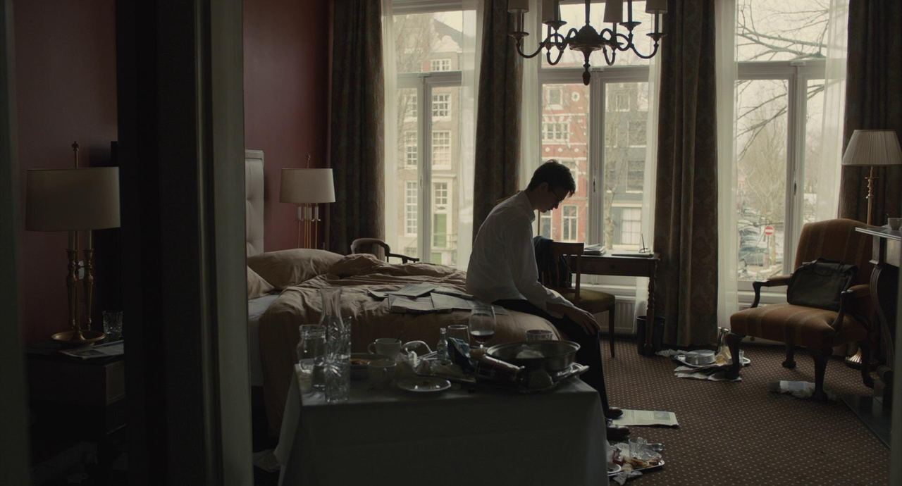
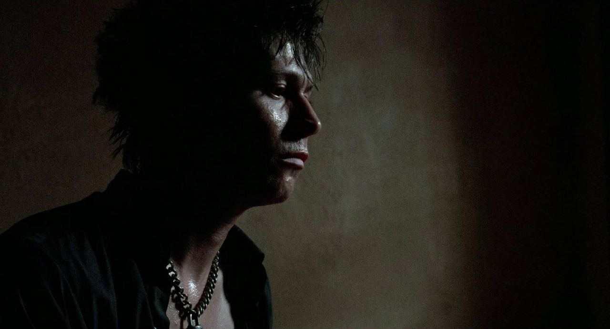
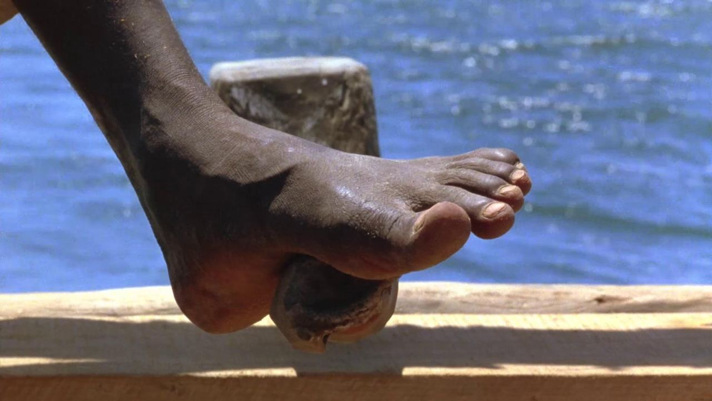

# 导演色卡 #058 — Roger Deakins 罗杰·迪金斯

> **分类**：03 大地暖调与自然光诗意 | **编号**：058 | **国籍**：英国 | **活跃年代**：1973-至今 | **创建日期**：2026-08-01

---

## 一、核心风格一句话
> 自然光大师的剪影窗光与雾蓝暖黄，精准如古典绘画的光影哲学。

---

## 二、色板构成

> 横版主色卡

### 主色板（6色）
| 色号 | HEX | 色彩名称 | 占比 | 来源说明 |
|------|-----|---------|------|---------|
| C01 | `#6B7B8C` | 雾霭蓝灰 | 22% | 1917战地雾 |
| C02 | `#C49A5C` | 琥珀暖黄 | 18% | 老无所依沙漠 |
| C03 | `#2A2E33` | 深炭暗影 | 15% | 银翼杀手夜影 |
| C04 | `#D9CDB8` | 羊皮纸米 | 15% | 窗光下肤色 |
| C05 | `#4A5568` | 钢蓝冷调 | 15% | 银翼杀手2049 |
| C06 | `#8B6F47` | 沙土金棕 | 15% | 老无所依德州 |

### 情绪色板（4色）
| 色号 | HEX | 色彩名称 | 情绪含义 |
|------|-----|---------|---------|
| E01 | `#D4AF37` | 窗光金 | 宁静启示 |
| E02 | `#00BFFF` | 赛博蓝 | 未来疏离 |
| E03 | `#708090` | 雾都灰 | 战争虚无 |
| E04 | `#CD853F` | 落日铜 | 宿命苍凉 |

### 光影特征
- **主光方向**：natural window light, precise silhouette framing, foggy blue-grey diffusion
- **高光色偏**：warm amber gold / pale cream
- **阴影色偏**：cool slate blue / deep charcoal
- **对比比**：high 70-85%
- **色调整体**：balanced naturalism, 50% warm + 50% cool

---

## 三、视觉风格关键词
### 构图与运镜
precision framing · natural window light · foggy atmosphere · silhouette against light · long takes (1917) · negative space · geometric composition · painterly chiaroscuro
### 色彩与光影
foggy slate blue · amber tungsten warm · charcoal deep shadow · parchment skin tone · desert sand gold · cyberpunk neon blue · window rim light · natural daylight precision
### 氛围与情绪
quiet contemplation · existential precision · dystopian beauty · wartime desolation · western stoicism · visual poetry · moral ambiguity · cinematic meditation

---

## 四、运镜特征
| 特征 | 说明 | 经典例子 |
|------|------|---------|
| 精准构图 | 几何式画面分割 | 《银翼杀手2049》沙漠 |
| 窗光剪影 | 人物侧影镶金边 | 《老无所依》汽车旅馆 |
| 雾霭氛围 | 雾气营造空间层次 | 《1917》战场雾 |
| 一镜到底 | 全片伪长镜头 | 《1917》穿越战场 |
| 负空间 | 大片留白突出孤独 | 《老无所依》德州荒原 |
| 明暗对比 | 伦勃朗式光影 | 《神枪手之死》 |
| 自然主义 | 纯自然光照明 | 《肖申克的救赎》 |
| 几何对称 | 建筑式构图秩序 | 《银翼杀手2049》废墟 |

---

## 五、经典场景色彩参考
### 电影截图画廊
| 1917 | 银翼杀手2049 | 老无所依 |
|--------|--------|--------|
|  |  |  |
| 雾霭蓝灰+羊皮纸米 · 战争虚无 | 钢蓝冷调+深炭暗影 · 未来疏离 | 琥珀暖黄+沙土金棕 · 西部宿命 |

| 肖申克的救赎 | 神枪手之死 | 逃狱三王 |
|--------|--------|--------|
|  | *神枪手之死（剧照未收录）* | *逃狱三王（剧照未收录）* |
| 羊皮纸米+深炭暗影 · 希望与自由 | 沙土金棕+雾霭蓝灰 · 传奇黄昏 | 琥珀暖黄+沙土金棕 · 南方民谣 |

雾蓝、琥珀与炭灰构成的精准世界，窗光与剪影把每个镜头炼成油画。

### 电影色彩速查
| 电影 | 场景 | 主导色 | 色彩氛围 |
|------|------|--------|---------|
| 1917 | 战壕穿越 | 雾霭蓝灰+羊皮纸米 | 战争虚无 |
| 银翼杀手2049 | 洛杉矶废墟 | 钢蓝冷调+深炭暗影 | 未来疏离 |
| 老无所依 | 德州公路追杀 | 琥珀暖黄+沙土金棕 | 西部宿命 |
| 肖申克的救赎 | 监狱逃狱 | 羊皮纸米+深炭暗影 | 希望与自由 |
| 神枪手之死 | 草原传奇 | 沙土金棕+雾霭蓝灰 | 传奇黄昏 |
| 逃狱三王 | 密西西比乡村 | 琥珀暖黄+沙土金棕 | 南方民谣 |
| 银翼杀手2049 | 沙漠橘园 | 落日铜+赛博蓝 | 末世诗意 |
| 1917 | 夜火废墟 | 深炭暗影+窗光金 | 黑暗中的光 |

---

## 六、AI 生成提示词模板
### 图像生成速用公式
```
[subject description], in the style of Roger Deakins, foggy slate blue, precision framing, cinematic film look, natural lighting, warm earth tones, quiet contemplation, --ar 16:9 --style raw
```
### 视频生成速用公式
```
A cinematic scene in Roger Deakins style, natural window light, precise silhouette framing, foggy blue-grey diffusion, foggy slate blue, precision framing, quiet contemplation, epic atmosphere, 16:9, cinematic movement
```

---

## 七、代表作索引
| 年份 | 片名 | 主要色彩特征 |
|------|------|-------------|
| 1994 | 肖申克的救赎 | 监狱自然光经典 |
| 2000 | 逃狱三王 | 南方暖黄民谣 |
| 2007 | 老无所依 | 西部宿命荒漠 |
| 2007 | 神枪手之死 | 草原传奇黄昏 |
| 2017 | 银翼杀手2049 | 赛博冷调未来 |
| 2019 | 1917 | 一镜到底战争 |
| 2022 | 光之帝国 | 海边电影怀旧 |

---

## 八、蒸馏验证
- [x] 色板6+4色已提取
- [x] 运镜特征已归纳（8种）
- [x] 提示词模板已生成（MJ/SD/视频）
- [ ] 电影截图参考图已收集
- [ ] Stable Diffusion 实测试图
- [ ] Runway 视频测试
