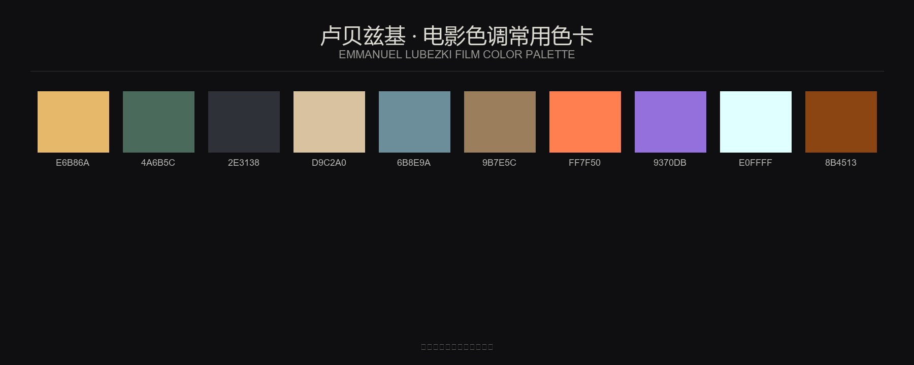
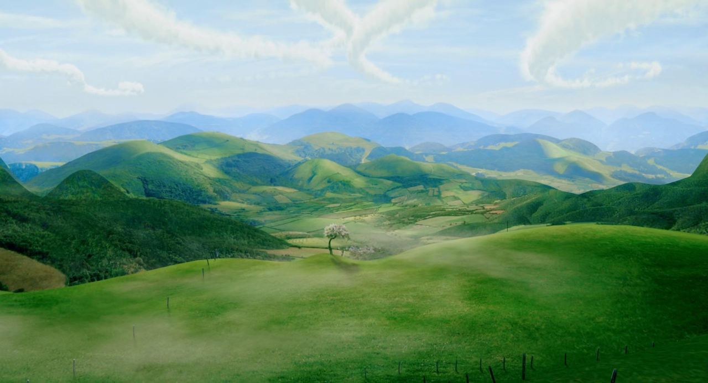
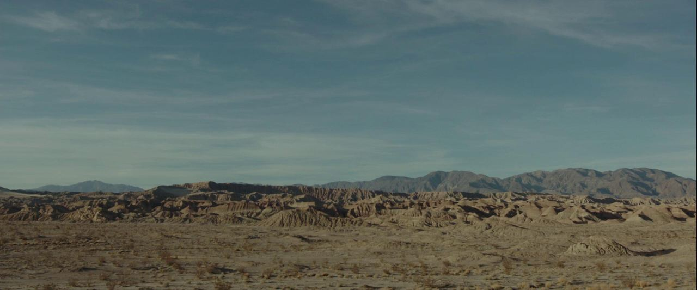
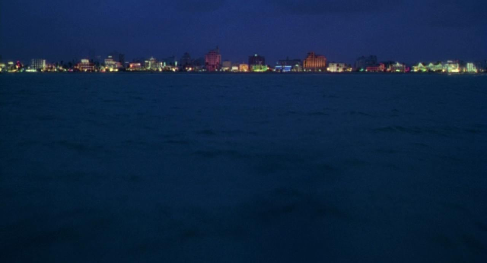

# 导演色卡 #059 — Emmanuel Lubezki 卢贝兹基

> **分类**：03 大地暖调与自然光诗意 | **编号**：059 | **国籍**：墨西哥 | **活跃年代**：1990-至今 | **创建日期**：2026-08-01

---

## 一、核心风格一句话
> 自然光长镜头与黄金时刻的呼吸感，光影如生命般流动的诗意影像。

---

## 二、色板构成

> 横版主色卡

### 主色板（6色）
| 色号 | HEX | 色彩名称 | 占比 | 来源说明 |
|------|-----|---------|------|---------|
| C01 | `#E6B86A` | 黄金时刻 | 22% | 荒野猎人晨曦 |
| C02 | `#4A6B5C` | 苔原冷绿 | 18% | 荒野猎人森林 |
| C03 | `#2E3138` | 黎明深灰 | 15% | 鸟人城市场景 |
| C04 | `#D9C2A0` | 暖沙肤色 | 15% | 自然光下肤色 |
| C05 | `#6B8E9A` | 冰湖蓝灰 | 15% | 荒野猎人冰原 |
| C06 | `#9B7E5C` | 大地赭石 | 15% | 大地与树皮 |

### 情绪色板（4色）
| 色号 | HEX | 色彩名称 | 情绪含义 |
|------|-----|---------|---------|
| E01 | `#FF7F50` | 日出火 | 生命觉醒 |
| E02 | `#9370DB` | 极光紫 | 神秘超越 |
| E03 | `#E0FFFF` | 霜雾白 | 寒冷纯净 |
| E04 | `#8B4513` | 土地棕 | 原始生存 |

### 光影特征
- **主光方向**：natural light only, golden hour magic hour, soft overcast diffusion
- **高光色偏**：golden amber / sunrise orange
- **阴影色偏**：cool forest green / blue-grey
- **对比比**：medium 55-70%
- **色调整体**：warm natural light, 60% warm + 40% cool

---

## 三、视觉风格关键词
### 构图与运镜
long continuous take · 360-degree camera movement · natural light only · golden hour magic hour · handheld intimacy · wide-angle immersion · breathing camera · nature as character
### 色彩与光影
golden hour sunrise · tundra moss green · frosty blue-grey · warm skin tones · earth ochre brown · dawn twilight purple · firelight orange · snowy white purity
### 氛围与情绪
spiritual transcendence · primal survival · theatrical intimacy · cosmic wonder · breathing existence · raw nature power · human vulnerability · dreamlike flow

---

## 四、运镜特征
| 特征 | 说明 | 经典例子 |
|------|------|---------|
| 一镜到底 | 全片无缝长镜头 | 《鸟人》百老汇后台 |
| 自然光照明 | 完全利用自然光 | 《荒野猎人》森林 |
| 黄金时刻 | 日出日落魔幻时刻 | 《荒野猎人》晨曦 |
| 360°环绕 | 摄影机环绕人物 | 《鸟人》舞台前后 |
| 手持呼吸 | 手持镜头微颤 | 《地心引力》太空 |
| 广角沉浸 | 超广角代入感 | 《荒野猎人》荒野 |
| 自然为角色 | 自然环境即角色 | 《荒野猎人》自然 |
| 光影呼吸 | 光线随时间变化 | 《人类之子》 |

---

## 五、经典场景色彩参考
### 电影截图画廊
| 荒野猎人 | 鸟人 | 地心引力 |
|--------|--------|--------|
|  |  |  |
| 黄金时刻+苔原冷绿 · 原始生存 | 黎明深灰+暖沙肤色 · 戏剧迷狂 | 冰湖蓝灰+暖沙肤色 · 宇宙孤独 |

| 人类之子 | 生命之树 | 大鱼 |
|--------|--------|--------|
|  | *生命之树（剧照未收录）* | *大鱼（剧照未收录）* |
| 大地赭石+苔原冷绿 · 末世希望 | 黄金时刻+霜雾白 · 宇宙诗意 | 黄金时刻+暖沙肤色 · 童话回忆 |

金辉、苔绿与冰蓝的自然光谱，长镜头与呼吸感把光影化为生命之流。

### 电影色彩速查
| 电影 | 场景 | 主导色 | 色彩氛围 |
|------|------|--------|---------|
| 荒野猎人 | 雪林求生 | 黄金时刻+苔原冷绿 | 原始生存 |
| 鸟人 | 百老汇后台 | 黎明深灰+暖沙肤色 | 戏剧迷狂 |
| 地心引力 | 太空漂浮 | 冰湖蓝灰+暖沙肤色 | 宇宙孤独 |
| 人类之子 | 末世伦敦 | 大地赭石+苔原冷绿 | 末世希望 |
| 生命之树 | 童年回忆 | 黄金时刻+霜雾白 | 宇宙诗意 |
| 大鱼 | 奇幻旅程 | 黄金时刻+暖沙肤色 | 童话回忆 |
| 荒野猎人 | 极光之夜 | 极光紫+冰湖蓝灰 | 神秘超越 |
| 人类之子 | 难民集中营 | 土地棕+大地赭石 | 人性挣扎 |

---

## 六、AI 生成提示词模板
### 图像生成速用公式
```
[subject description], in the style of Emmanuel Lubezki, golden hour sunrise, long continuous take, cinematic film look, natural lighting, warm earth tones, spiritual transcendence, --ar 16:9 --style raw
```
### 视频生成速用公式
```
A cinematic scene in Emmanuel Lubezki style, natural light only, golden hour magic hour, soft overcast diffusion, golden hour sunrise, long continuous take, spiritual transcendence, epic atmosphere, 16:9, cinematic movement
```

---

## 七、代表作索引
| 年份 | 片名 | 主要色彩特征 |
|------|------|-------------|
| 2003 | 大鱼 | 童话暖金回忆 |
| 2006 | 人类之子 | 末世长镜头 |
| 2011 | 生命之树 | 宇宙诗意自然 |
| 2013 | 地心引力 | 太空视觉奇观 |
| 2014 | 鸟人 | 一镜到底戏剧 |
| 2015 | 荒野猎人 | 黄金时刻生存 |
| 2022 | 阿姆斯特丹 | 复古暖调喜剧 |

---

## 八、蒸馏验证
- [x] 色板6+4色已提取
- [x] 运镜特征已归纳（8种）
- [x] 提示词模板已生成（MJ/SD/视频）
- [ ] 电影截图参考图已收集
- [ ] Stable Diffusion 实测试图
- [ ] Runway 视频测试
