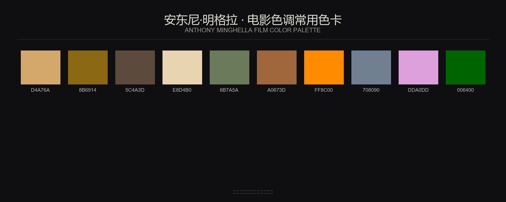
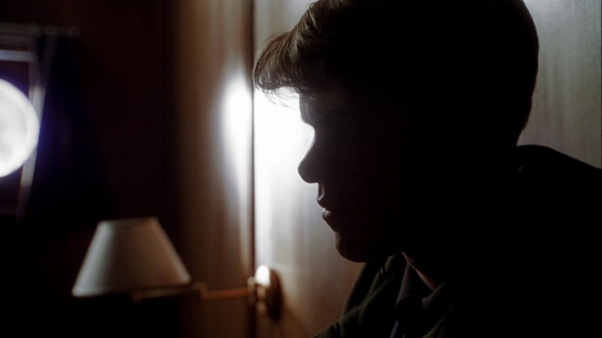
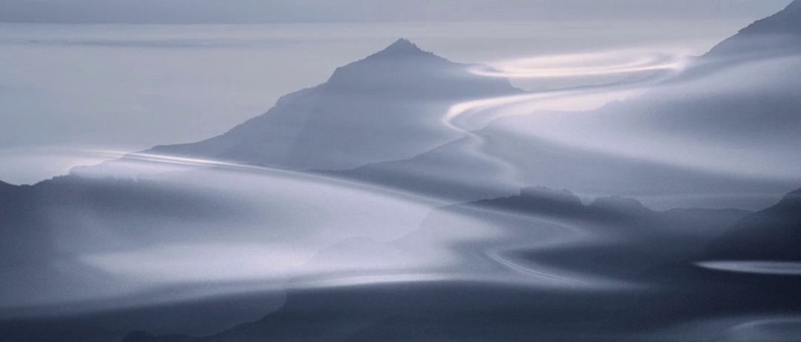

# 导演色卡 #060 — Anthony Minghella 安东尼·明格拉

> **分类**：03 大地暖调与自然光诗意 | **编号**：060 | **国籍**：英国 | **活跃年代**：1978-2008 | **创建日期**：2026-08-01

---

## 一、核心风格一句话
> 沙漠金暖与柔光回忆交织的史诗浪漫，文学改编的影像诗人。

---

## 二、色板构成

> 横版主色卡

### 主色板（6色）
| 色号 | HEX | 色彩名称 | 占比 | 来源说明 |
|------|-----|---------|------|---------|
| C01 | `#D4A76A` | 沙漠流金 | 22% | 英国病人撒哈拉 |
| C02 | `#8B6914` | 橄榄暗金 | 18% | 天才雷普利意大利 |
| C03 | `#5C4A3D` | 深褐木影 | 15% | 冷山木屋 |
| C04 | `#E8D4B0` | 柔光米色 | 15% | 回忆场景暖光 |
| C05 | `#6B7A5A` | 橄榄灰绿 | 15% | 意大利乡村 |
| C06 | `#A0673D` | 陶土砖红 | 15% | 北非建筑 |

### 情绪色板（4色）
| 色号 | HEX | 色彩名称 | 情绪含义 |
|------|-----|---------|---------|
| E01 | `#FF8C00` | 沙漠橙 | 炽热爱情 |
| E02 | `#708090` | 战争灰 | 生离死别 |
| E03 | `#DDA0DD` | 梅香紫 | 回忆温柔 |
| E04 | `#006400` | 深林绿 | 隐忍思念 |

### 光影特征
- **主光方向**：golden desert haze, soft memory diffusion, romantic natural light
- **高光色偏**：warm honey gold / sand amber
- **阴影色偏**：umber brown / olive green
- **对比比**：medium-low 50-65%
- **色调整体**：warm golden romantic, 70% warm + 30% cool

---

## 三、视觉风格关键词
### 构图与运镜
sweeping desert vistas · soft focus memory · romantic close-up · period costume detail · window light portrait · epic landscape framing · slow dissolve transition · mirrored reflections
### 色彩与光影
sahara desert gold · tuscan olive green · soft cream memory · terracotta warm red · honey amber sunset · dusty golden haze · warm skin tones · literary romantic palette
### 氛围与情绪
epic romance · wartime longing · memory and nostalgia · literary tragedy · mediterranean warmth · unspoken desire · soulful melancholy · grand human drama

---

## 四、运镜特征
| 特征 | 说明 | 经典例子 |
|------|------|---------|
| 沙漠远景 | 浩瀚沙漠中的渺小人物 | 《英国病人》撒哈拉 |
| 柔光回忆 | 柔焦处理记忆片段 | 《英国病人》闪回 |
| 窗光肖像 | 窗光勾勒面部轮廓 | 《天才雷普利》肖像 |
| 史诗长镜 | 宏大战争场面调度 | 《冷山》战役 |
| 慢溶转场 | 回忆与现实交融 | 《英国病人》时空交错 |
| 镜子反射 | 人物内心镜像 | 《天才雷普利》威尼斯 |
| 乡村田园 | 意大利乡野油画感 | 《天才雷普利》海边 |
| 雪夜暖炉 | 冷暖对比的情感 | 《冷山》归途 |

---

## 五、经典场景色彩参考
### 电影截图画廊
| 英国病人 | 天才雷普利 | 冷山 |
|--------|--------|--------|
|  |  | *冷山（剧照未收录）* |
| 沙漠流金+柔光米色 · 史诗爱情 | 橄榄暗金+橄榄灰绿 · 欲望迷局 | 深褐木影+战争灰 · 战争相思 |

| 天才雷普利 | 英国病人 | 冷山 |
|--------|--------|--------|
| *天才雷普利（剧照未收录）* | *英国病人（剧照未收录）* | *冷山（剧照未收录）* |
| 陶土砖红+橄榄暗金 · 威尼斯迷雾 | 沙漠流金+深褐木影 · 山洞誓言 | 深林绿+柔光米色 · 雪中重逢 |

沙金、橄榄与柔光米色的文学世界，慢溶与长镜把回忆化为流动的情书。

### 电影色彩速查
| 电影 | 场景 | 主导色 | 色彩氛围 |
|------|------|--------|---------|
| 英国病人 | 撒哈拉沙漠 | 沙漠流金+柔光米色 | 史诗爱情 |
| 天才雷普利 | 意大利海岸 | 橄榄暗金+橄榄灰绿 | 欲望迷局 |
| 冷山 | 南北战争 | 深褐木影+战争灰 | 战争相思 |
| 天才雷普利 | 威尼斯水道 | 陶土砖红+橄榄暗金 | 身份迷局 |
| 英国病人 | 山洞誓言 | 沙漠流金+深褐木影 | 永恒承诺 |
| 冷山 | 雪夜归途 | 深林绿+柔光米色 | 历尽重逢 |
| 英国病人 | 修道院回忆 | 柔光米色+梅香紫 | 温柔回忆 |
| 天才雷普利 | 爵士酒吧 | 陶土砖红+沙漠橙 | 欲望诱惑 |

---

## 六、AI 生成提示词模板
### 图像生成速用公式
```
[subject description], in the style of Anthony Minghella, sahara desert gold, sweeping desert vistas, cinematic film look, natural lighting, warm earth tones, epic romance, --ar 16:9 --style raw
```
### 视频生成速用公式
```
A cinematic scene in Anthony Minghella style, golden desert haze, soft memory diffusion, romantic natural light, sahara desert gold, sweeping desert vistas, epic romance, epic atmosphere, 16:9, cinematic movement
```

---

## 七、代表作索引
| 年份 | 片名 | 主要色彩特征 |
|------|------|-------------|
| 1990 | 一屋一鬼一情人 | 浪漫幽灵爱情 |
| 1996 | 英国病人 | 沙漠史诗爱情 |
| 1999 | 天才雷普利 | 意大利欲望悬疑 |
| 2003 | 冷山 | 南北战争史诗 |
| 2006 | 解构生活 | 伦敦当代戏剧 |
| 2008 | 纽约，我爱你 | 短篇集导演 |

---

## 八、蒸馏验证
- [x] 色板6+4色已提取
- [x] 运镜特征已归纳（8种）
- [x] 提示词模板已生成（MJ/SD/视频）
- [ ] 电影截图参考图已收集
- [ ] Stable Diffusion 实测试图
- [ ] Runway 视频测试
